# Ontology-Grounded Healthcare Chatbot & Diagnostic System

[](https://python.org)
[](https://neo4j.com)
[](https://flutter.dev)
[](https://www.snomed.org/)
[](LICENSE)

An intelligent clinical inquiry and preliminary diagnosis assistant designed to eliminate large language model (LLM) hallucinations through ontology-anchored knowledge grounding. By implementing **Graph-Augmented Retrieval (GraphRAG)** with a structured **SNOMED-CT** graph and chunked medical truths, the system provides traceable, factually grounded health guidance through a cross-platform mobile chatbot interface.

---

## 🌟 Key Features

### 1. GraphRAG Retrieval Architecture

- **Ontology Anchoring:** Implemented a Neo4j knowledge graph grounded in SNOMED-CT ontologies to link formal clinical entities with lay terminology, enforcing semantic consistency and preventing inaccurate relationship formation across chunked medical documents.
- **Literature Grounding:** Ingests external, verified medical documents preprocessed and chunked into contextual units, linked directly to relevant SNOMED-CT concept nodes.
- **Hallucination Mitigation:** Ensures generation is strictly bounded to verified medical information, enabling verifiable references.

### 2. Conversational Mobile Application

- **Cross-Platform Client:** Developed with **Flutter** for seamless execution across iOS and Android.
- **Authentication & Security:** Secure token-based session handling via **JWT (JSON Web Tokens)**.
- **Conversation Lifecycle:** Complete state persistence allowing users to create new conversation, review past conversation histories, and delete past conversations.
- **Responsive RESTful Backend:** Powered by **Flask** server routing queries between graph traversal pipelines and LLM inference endpoints.
- **Real-Time Token Streaming:** Delivers live, progressive response rendering via WebSocket streaming

### 3. Main Conversation Features

- **Query Disease Information:** Enables users to retrieve structured medical insights—including disease definition, symptoms, and recommended treatments by querying the knowledeg graph
- **Preliminary Diagnosis:** Analyzes user-reported symptoms to generate probabilistic condition assessments

---

## 🏗️ System Architecture

```text
  +-------------------------------------------------------------+
  |                   Flutter Mobile Client                     |
  |  - JWT Authentication    - History Management               |
  +------------------------------+------------------------------+
                                 | REST API / JSON / WebSocket
                                 v
  +----------------------------------------------------------------------+
  |                     Flask Backend API                                |
  |  - Auth & Query Router   - RAG Orchestrator  - LLM Message Streaming |
  +------------------------------+---------------------------------------+
                                 |
         +-----------------------+-----------------------+
         |                                               |
         v                                               v
+-------------------------------+               +-------------------------------+
|     Neo4j Knowledge Graph     |               |         Medical Document      |
| - SNOMED-CT Concept Hierarchy | <--- Linked - | - Preprocessed & Chunked      |
|                               |               |   Literature                  |
+-------------------------------+               +-------------------------------+
                                 \             /
                                  \           /
                                   v         v
                      +----------------------------------------+
                      |       LLM Generation                   |
                      |   Grounding & PreliminaryDiagnostics   |
                      +----------------------------------------+
```

---

---

## 🛠️ Tech Stack

- **Frontend:** Flutter
- **Backend:** Flask
- **Knowledge Graph:** Neo4j
- **Database:** MongoDB
- **Medical Terminology:** SNOMED-CT
- **Information Retrieval:** GraphRAG and Cosine Similarity
- **Evaluation Frameworks:** DeepEval

---

## 🖼️ Screenshots

### Preliminary Diagnosis

<table>
  <tr>
    <th colspan="4">Providing Preliminary Diagnosis</th>
  </tr>
  <tr>
    <td align="center" width="25%">
      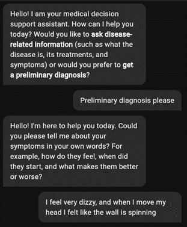
      <br />
      <b>Describe Symptoms</b>
    </td>
    <td align="center" width="25%">
      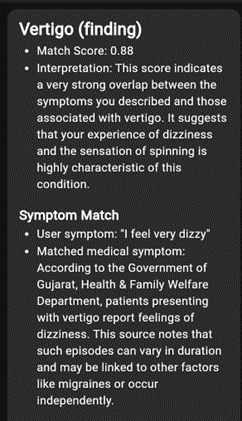
      <br />
      <b>Initial Assessment - 1</b>
    </td>
    <td align="center" width="25%">
      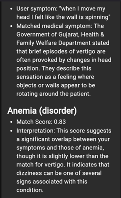
      <br />
      <b>Initial Assessment - 2</b>
    </td>
    <td align="center" width="25%">
      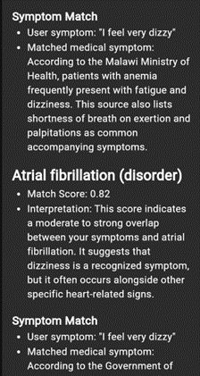
      <br />
      <b>Initial Assessment - 3</b>
    </td>
  </tr>
  <tr>
    <td colspan="4" align="center">
      <p>Users describe the symptoms they are experiencing in natural language, prompting the chatbot to return an initial preliminary diagnosis.</p>
    </td>
  </tr>
</table>

<table>
  <tr>
    <th colspan="3">Refining Diagnosis Results</th>
  </tr>
  <tr>
    <td align="center" width="33%">
      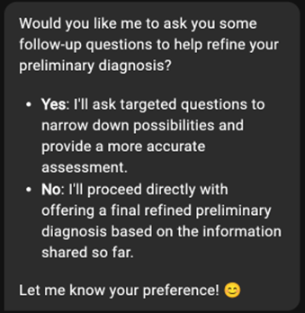
      <br />
      <b>Clarification Prompt</b>
    </td>
    <td align="center" width="33%">
      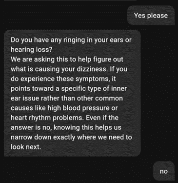
      <br />
      <b>Intake Question 1</b>
    </td>
    <td align="center" width="33%">
      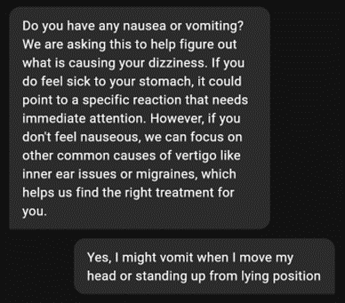
      <br />
      <b>Intake Question 2</b>
    </td>
  </tr>
  <tr>
    <td colspan="3" align="center">
      <p>To narrow down possibilities, users can complete a five-question interactive follow-up assessment tailored to their initial inputs.</p>
    </td>
  </tr>
</table>

<table>
  <tr>
    <th colspan="3">Refined Diagnosis Result</th>
  </tr>
  <tr>
    <td align="center" width="33%">
      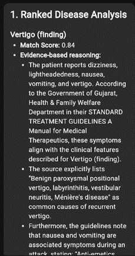
      <br />
      <b>Updated Ranking - 1</b>
    </td>
    <td align="center" width="33%">
      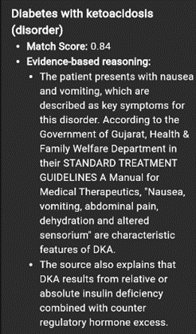
      <br />
      <b>Updated Ranking - 2</b>
    </td>
    <td align="center" width="33%">
      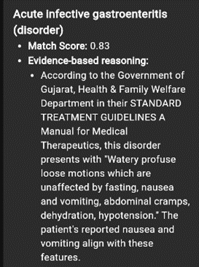
      <br />
      <b>Updated Ranking - 3</b>
    </td>
  </tr>
  <tr>
    <td colspan="3" align="center">
      <p>Once all follow-up questions are completed, the system recalculates the probability by matching user described symptoms against diseases symptoms.</p>
    </td>
  </tr>
</table>

### Query Disease Information

<table>
  <tr>
    <th colspan="3">Querying Disease Information</th>
  </tr>
  <tr>
    <td align="center" width="33%">
      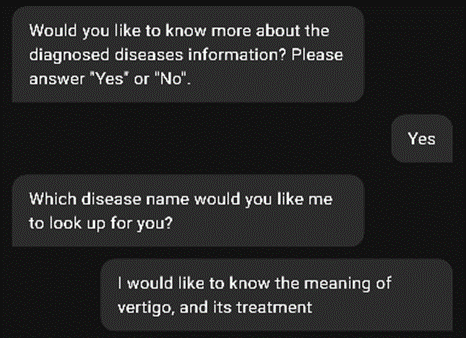
      <br />
      <b>Disease Inquiry</b>
    </td>
    <td align="center" width="33%">
      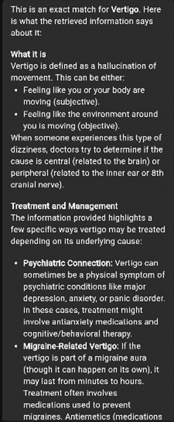
      <br />
      <b>Clinical Overview - 1</b>
    </td>
    <td align="center" width="33%">
      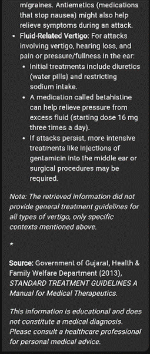
      <br />
      <b>Clinical Overview - 2</b>
    </td>
  </tr>
  <tr>
    <td colspan="3" align="center">
      <p>Users can query detailed clinical information directly after diagnosis, retrieving descriptions, common causes, and treatment guidelines.</p>
    </td>
  </tr>
</table>

---

## 📊 Evaluation & Benchmarks

The diagnostic and retrieval pipeline was evaluated using **DeepEval** against clinical test cases to measure faithfulness, retrieval accuracy, and disease retrieval given symptoms rankings.

| Metric                |   Score    | Description                                                                                               |
| :-------------------- | :--------: | :-------------------------------------------------------------------------------------------------------- |
| **Contextual Recall** | **93.00%** | Completeness of retrieving the required medical contexts to answer user's query                           |
| **Faithfulness**      | **78.00%** | Factual consistency of generated responses grounded against retrieved context.                            |
| **Answer Relevancy**  | **78.00%** | Direct alignment between the diagnostic inquiry and the synthesized clinical guidance.                    |
| **Disease Hit@5**     | **73.33%** | Probability that the correct target condition appears within the top 5 suggested differential diagnoses.  |
| **Disease Hit@10**    | **70.00%** | Probability that the correct target condition appears within the top 10 suggested differential diagnoses. |
